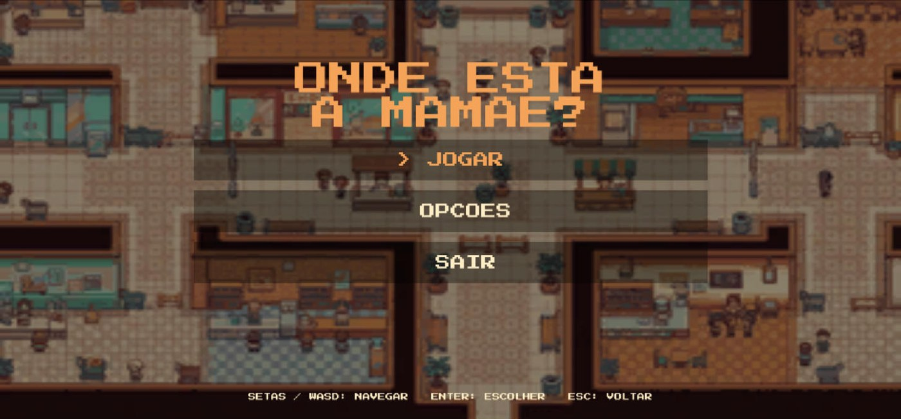
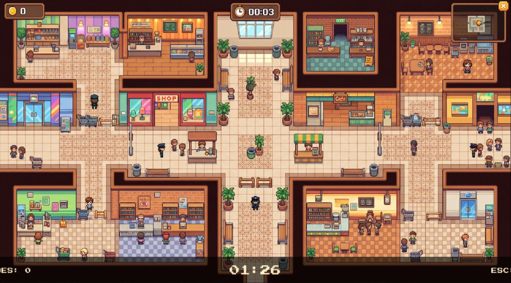
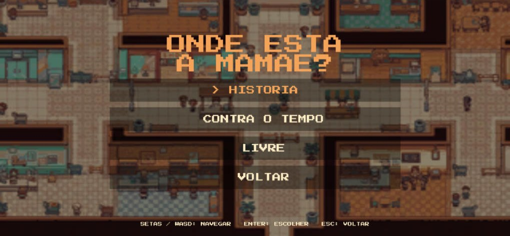
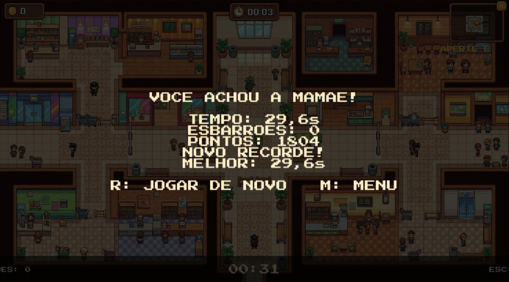
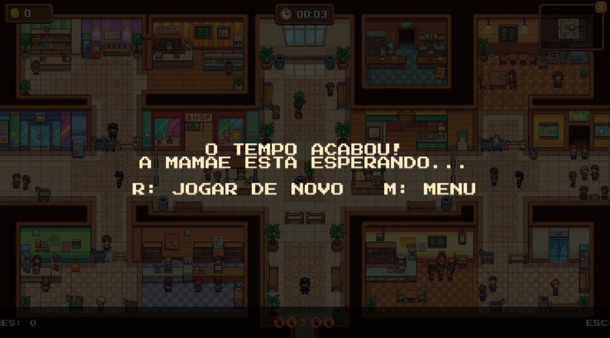
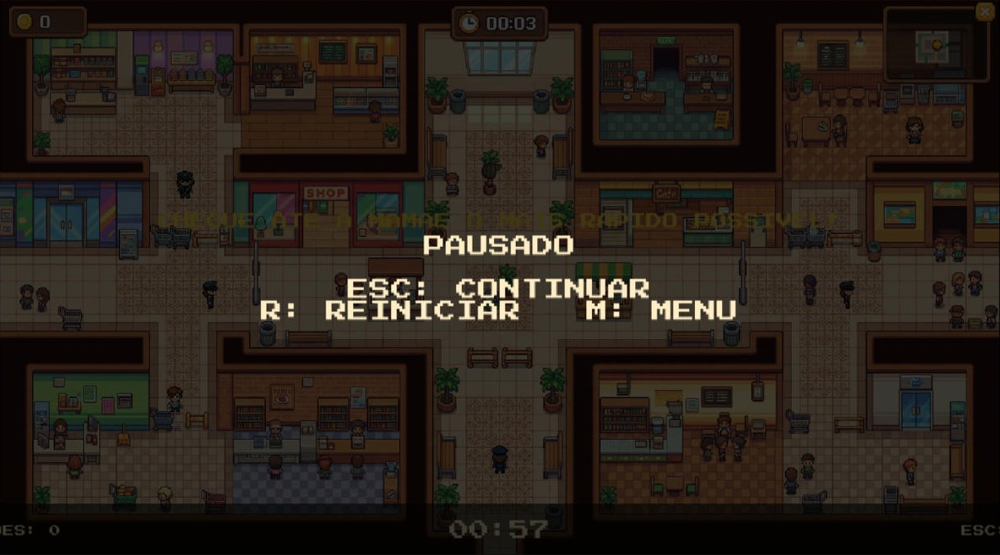
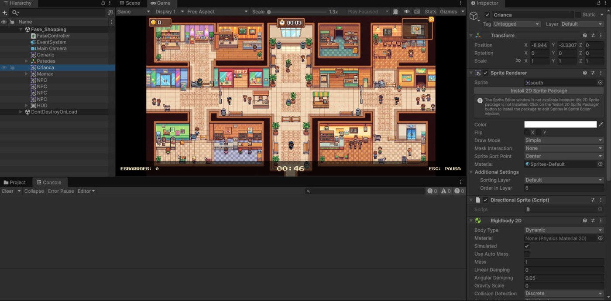

<div align="center">



# 🛍️ Onde Está a Mamãe?
### *Where's Mommy* — versão Unity

**Uma criança se perdeu no shopping. O relógio está correndo. Encontre a mamãe!**


<br>


[Sobre](#-sobre) • [Como jogar](#-como-jogar) • [Modos](#-modos-de-jogo) • [Abrindo o projeto](#-abrindo-o-projeto) • [Estrutura](#-estrutura-do-projeto) • [Roadmap](#-roadmap)

</div>

---

## 🧒 Sobre

Foi só um segundo: a criança soltou a mão da mãe para olhar uma vitrine e, quando virou, ela tinha sumido no meio da multidão.

**Onde Está a Mamãe?** é um jogo de labirinto **2D em pixel art**, com visão de cima, em que você guia a criança pelos corredores de um shopping movimentado. Desvie dos policiais que patrulham, escolha a melhor rota e chegue até a mamãe **antes que o tempo acabe**.

> 💡 Nada de violência: o desafio é **orientação espacial**, **planejamento de rota** e **controle do tempo**.

Esta é a implementação em **Unity** do projeto [WhereIsMommy](https://github.com/pedro-salvestro/WhereIsMommy) (UC Desenvolvimento de Games, UNIFESP), usando a arte e o áudio do repositório original.

<div align="center">

<br><sub>A fase do shopping: cronômetro, contador de esbarrões e policiais patrulhando.</sub>
</div>

## 🎮 Como jogar

| Ação | ⌨️ Tecla |
|:--|:--:|
| Andar | `W` `A` `S` `D` ou setas |
| Falar com a mamãe | `E` ou `Espaço` |
| Pausar | `Esc` |
| Reiniciar / voltar ao menu (pausa ou fim de jogo) | `R` / `M` |

**Objetivo:** atravessar o shopping, chegar perto da mamãe (canto superior direito) e apertar **E** quando aparecer o aviso.

### 🧮 Pontuação

```
pontos = 1000 + (tempo restante × 10) + bônus de eficiência
bônus de eficiência = máx(0, 500 − 100 × esbarrões)
```

Cada esbarrão em uma pessoa ou policial custa **5 segundos**.

## 🕹️ Modos de jogo

| | Modo | Como funciona |
|:--:|:--|:--|
| 📖 | **História** | 90 s para achar a mamãe, com mensagem de abertura |
| ⏱️ | **Contra o Tempo** | 60 s e recorde de melhor tempo salvo |
| 🌿 | **Livre** | Sem cronômetro nem derrota por tempo |

<div align="center">

</div>

## 📸 Telas

<table>
<tr>
<td align="center" width="33%"><br><sub>Reencontro: tempo, esbarrões e pontos</sub></td>
<td align="center" width="33%"><br><sub>Tempo esgotado</sub></td>
<td align="center" width="33%"><br><sub>Pausa (Esc)</sub></td>
</tr>
</table>

## 🚀 Abrindo o projeto

1. Instale o **[Unity Hub](https://unity.com/download)** e o **Unity 6** (versão `6000.x`).
2. Clone o repositório:
   ```bash
   git clone <url-deste-repositorio>
   ```
3. No Hub: **Add → Add project from disk** e escolha a pasta clonada.
4. Ao abrir, as cenas `Menu` e `Fase_Shopping` são geradas sozinhas (ou use **Mamae → Gerar Cenas**).
5. Abra `Assets/Scenes/Menu.unity` e aperte **Play** ▶️

> O projeto funciona tanto com o Input System novo quanto com o Input Manager antigo.

<details>
<summary><b>📁 Estrutura do projeto</b></summary>

```
WhereIsMommy-Unity/
├── Assets/
│   ├── Editor/
│   │   └── ProjectSetup.cs        Importação dos sprites e geração das cenas
│   ├── Resources/
│   │   ├── Art/                   Cenários, criança, mãe, policial e fundos do menu
│   │   ├── Audio/                 Música do menu e efeitos
│   │   └── Fonts/                 Press Start 2P
│   └── Scripts/
│       ├── Common.cs              Áudio, sprite direcional e utilitários de UI
│       ├── Inp.cs                 Entrada de teclado unificada
│       ├── MenuController.cs      Menu, modos e opções
│       └── LevelController.cs     Fase, jogador, patrulhas, HUD e pontuação
├── Packages/manifest.json
└── ProjectSettings/
```

</details>

<details>
<summary><b>⚙️ Como funciona</b></summary>

- **Tudo por código:** menu, HUD e fase são montados em `Start()`, então as cenas ficam quase vazias.
- **Mapa e colisões:** o cenário é uma imagem; as paredes e móveis são retângulos em coordenadas da imagem, convertidos para o mundo (`Walls` em `LevelController.cs`).
- **Personagens:** `DirectionalSprite` escolhe entre 8 sprites pelo vetor de movimento.
- **Obstáculos:** `PatrolNPC` percorre dois pontos; o contato com a criança chama `LevelController.Hit()`.
- **Objetivo:** `MommyGoal` detecta a proximidade e espera a tecla de interação.

<div align="center">

</div>

</details>

## 📍 Roadmap

- [x] **MVP:** criança controlável, 1 mapa, cronômetro, mamãe como objetivo, obstáculos móveis, vitória/derrota e pontuação
- [x] **Modos:** História, Contra o Tempo e Livre
- [ ] **Conteúdo:** novos mapas (mercado e parque), mais tipos de NPC, pistas e atalhos
- [ ] **Polimento:** animações de caminhada, conquistas e cenas de história
- [ ] **Futuro:** mapas procedurais, cosméticos e versão web

## 👥 Equipe

<table>
<tr>
<td align="center">🧑‍💻<br><b>Luiz Eduardo</b><br><sub>Garcia de Siqueira</sub></td>
<td align="center">🧑‍💻<br><b>Flavio Henrique</b><br><sub>Ferreira</sub></td>
<td align="center">🧑‍💻<br><b>Breno</b><br><sub>de Morais Gobato</sub></td>
<td align="center">🧑‍💻<br><b>Pedro</b><br><sub>Borin Salvestro</sub></td>
</tr>
</table>

<div align="center">

🎓 Projeto da UC **Desenvolvimento de Games**<br>
**UNIFESP** · Instituto de Ciência e Tecnologia · Bacharelado em Ciência e Tecnologia

<sub>Arte e áudio originais do repositório <a href="https://github.com/pedro-salvestro/WhereIsMommy">WhereIsMommy</a>. Feito com 💖 e muitos pixels.</sub>

</div>
