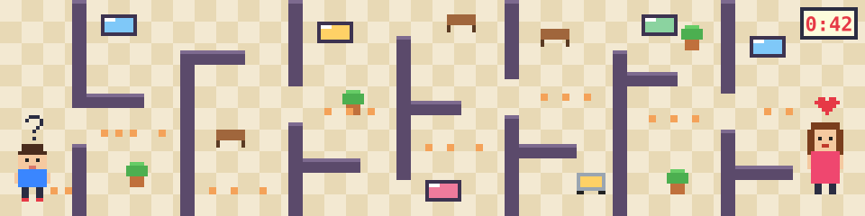
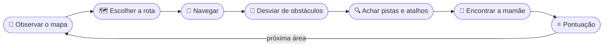

<div align="center">



# 🛍️ Onde Está a Mamãe?
### *Where's Mommy*

**Uma criança se perdeu no shopping. O relógio está correndo. Encontre a mamãe!**

[](https://godotengine.org)
[](https://docs.godotengine.org/pt-br/4.x/tutorials/scripting/gdscript/)
[](https://www.aseprite.org)
<br>


[](LICENSE)

[Sobre](#-sobre-o-jogo) • [Como jogar](#-como-jogar) • [O shopping](#-o-shopping) • [Rodando o projeto](#-rodando-o-projeto) • [Roadmap](#-roadmap) • [Equipe](#-equipe)

</div>

---

## 🧒 Sobre o jogo

Foi só um segundo. A criança soltou a mão da mãe para olhar uma vitrine e, quando virou, ela tinha sumido no meio da multidão.

**Onde Está a Mamãe?** é um jogo de labirinto **2D em pixel art**, com visão de cima, em que você guia uma criança pelos corredores de um shopping movimentado. Escolha rotas, desvie de pessoas e carrinhos, siga as pistas e chegue até a mamãe **antes que o tempo acabe**.

> 💡 Nada de inimigos ou violência: o desafio é **orientação espacial**, **planejamento de rota** e **controle do tempo**.

<table>
<tr>
<td align="center" width="25%">🧭<br><b>Labirintos variados</b><br><sub>corredores, lojas e áreas abertas</sub></td>
<td align="center" width="25%">⏱️<br><b>Contra o relógio</b><br><sub>urgência leve, sem frustração</sub></td>
<td align="center" width="25%">🚶<br><b>Obstáculos que andam</b><br><sub>pessoas, filas e carrinhos</sub></td>
<td align="center" width="25%">⭐<br><b>Pontuação</b><br><sub>tempo, eficiência e rota perfeita</sub></td>
</tr>
</table>

## 🎮 Como jogar

| Ação | ⌨️ Teclado | 🎮 Controle |
|:--|:--:|:--:|
| Andar | `W` `A` `S` `D` ou setas | Direcional / analógico |
| Interagir | `E` ou `Espaço` | Botão principal |
| Pausar | `Esc` | Start / Menu |
| Correr *(em estudo)* | `Shift` | — |

### 🔁 O ciclo de jogo



**Pontuação** = pontos-base + (tempo restante × bônus de tempo) + bônus de eficiência

### 🕹️ Modos de jogo

| | Modo | Como funciona |
|:--:|:--|:--|
| 📖 | **História** | Áreas em sequência, cada vez maiores, com pequenas cenas entre elas |
| ⏱️ | **Contra o Tempo** | Termine cada labirinto no menor tempo possível |
| 🌿 | **Livre** | Explore sem cronômetro, sem pressão |

## 🏬 O shopping

| | Área | O que esperar |
|:--:|:--|:--|
| 🪑 | **Corredores centrais** | Quiosques, bancos e pouca gente. Onde tudo começa. |
| 👕 | **Lojas** | Corredores estreitos, vitrines e atalhos escondidos |
| 🍔 | **Praça de alimentação** | Mesas, filas e muita gente: hora de achar outro caminho |
| 🎬 | **Cinema** | Luz baixa, cartazes e filas |
| 🚗 | **Estacionamento** | O grande desafio final: pilares, carrinhos e áreas bloqueadas |

### 🚧 Obstáculos

`🚶 pessoas caminhando` `👨‍👩‍👧 grupos parados` `🧹 carrinhos de limpeza` `🪑 bancos e quiosques` `🚧 áreas em manutenção` `🧍‍♂️🧍‍♀️ filas`

### 🏆 Conquistas

| | |
|:--|:--|
| ⚡ **Reencontro Relâmpago** | Terminar com muito tempo sobrando |
| 🫧 **Sem Esbarrar** | Concluir sem nenhuma colisão |
| 🧭 **Explorador** | Visitar áreas opcionais |
| 🏬 **Conheço o Shopping** | Finalizar o Modo História |
| ✨ **Rota Perfeita** | Atingir a meta de eficiência |

## 🚀 Rodando o projeto

1. Instale o **[Godot 4](https://godotengine.org/download)** (versão padrão, não precisa da .NET).
2. Clone o repositório:
   ```bash
   git clone https://github.com/<seu-usuario>/onde-esta-a-mamae.git
   ```
3. No Godot, clique em **Importar** e escolha `game/project.godot`.
4. Aperte **F5** e procure a mamãe! 💖

<details>
<summary><b>📁 Estrutura do repositório</b></summary>

```
onde-esta-a-mamae/
├── 📄 docs/              GDD, roadmap, guia de arte e de contribuição
├── 🎨 art/
│   ├── aseprite/         Arquivos-fonte .aseprite (personagens, npcs, tiles, ui)
│   └── referencias/      Referências visuais
├── 🎵 audio/             Fontes de música e efeitos
└── 🎮 game/              Projeto Godot
    ├── assets/           Sprites, tilesets, áudio e fontes exportados
    ├── scenes/           Cenas (player, npcs, levels, ui)
    ├── scripts/          Scripts GDScript
    └── autoload/         Estado global (cronômetro, pontuação)
```

</details>

<details>
<summary><b>🎨 Padrões de pixel art</b></summary>

| | |
|:--|:--|
| Tile | 16×16 px |
| Criança | ~16×24 px em quadro de 32×32 |
| Resolução base | 320×180, escala inteira (×4 = 720p, ×6 = 1080p) |
| Animações | parado, caminhada, esbarrão, preocupação, comemoração |
| Direções | ⬆️ ⬇️ ⬅️ ➡️ |

Detalhes no [guia de arte](docs/ART_GUIDE.md).

</details>

## 📍 Roadmap

- [ ] **🎯 MVP**: criança controlável, 1 mapa, cronômetro, mamãe como objetivo, 2 obstáculos móveis, vitória/derrota e pontuação
- [ ] **🏬 Conteúdo**: novos mapas, mais NPCs, sistema de pistas, animações e áudio
- [ ] **⏱️ Modos**: Contra o Tempo, Modo Livre, cenas da história e conquistas
- [ ] **🌀 Futuro**: mapas procedurais, cosméticos e versão web

Lista completa em [`docs/ROADMAP.md`](docs/ROADMAP.md) e nas [issues](../../issues).

## 📚 Documentação

| | |
|:--|:--|
| 📕 [GDD completo (PDF)](docs/) | O documento de design original |
| 📝 [GDD resumido](docs/GDD.md) | O essencial em uma página |
| 🎨 [Guia de arte](docs/ART_GUIDE.md) | Aseprite, paleta, tags e exportação |
| 🤝 [Como contribuir](docs/CONTRIBUTING.md) | Branches, commits e pull requests |

## 👥 Equipe

<table>
<tr>
<td align="center">🧑‍💻<br><b>Luiz Eduardo</b><br><sub>Garcia de Siqueira</sub></td>
<td align="center">🧑‍💻<br><b>Flavio Henrique</b><br><sub>Ferreira</sub></td>
<td align="center">🧑‍💻<br><b>Breno</b><br><sub>de Morais Gobato</sub></td>
<td align="center">🧑‍💻<br><b>Pedro</b><br><sub>Borin Salvestro</sub></td>
</tr>
</table>

<div align="center">

🎓 Projeto da UC **Desenvolvimento de Games**<br>
**UNIFESP** · Instituto de Ciência e Tecnologia · Bacharelado em Ciência e Tecnologia<br>
Prof. Fabio Augusto Menocci Cappabianco · 2026

---

<sub>Código sob licença <a href="LICENSE">MIT</a>. Arte e áudio originais pertencem à equipe.</sub><br>
<sub>Inspirado em Pac-Man, Crossy Road e Bomberman. Feito com 💖 e muitos pixels.</sub>

</div>
