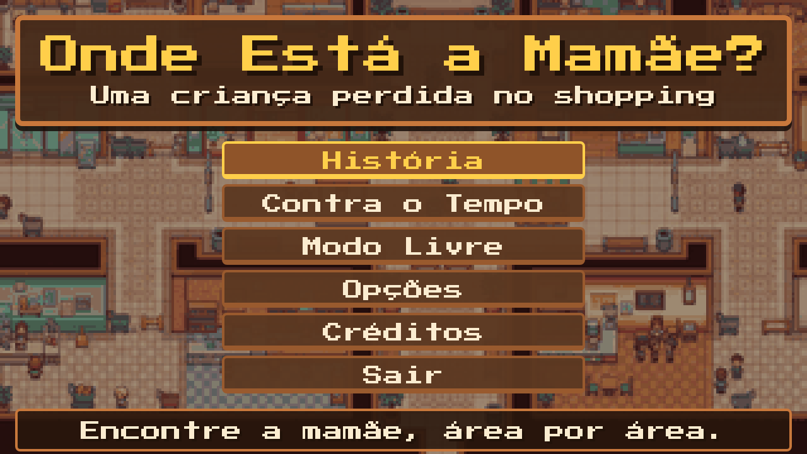

# Onde Está a Mamãe? · Menu inicial

Menu inicial do jogo **Onde Está a Mamãe?** feito em HTML, CSS e JavaScript puro, sem bibliotecas.
Visual em pixel art (resolução base 320×180, ampliada em números inteiros), no estilo do HUD dos cenários do jogo.



## Como rodar

Precisa do [Node.js](https://nodejs.org/) instalado.

```bash
npm start
```

Abra **http://localhost:8080** no navegador.
Para usar outra porta: `PORT=3000 npm start`.

## O que o menu tem

- Título e fundo que alterna entre os cenários (shopping, parque e mercado).
- Modos do GDD: **História**, **Contra o Tempo** e **Modo Livre**.
- **Opções**: volume de música, volume de efeitos, reduzir animações e tela cheia (salvas no navegador).
- **Créditos** e **Sair**.
- Controles: setas ou W/S para navegar, Enter ou Espaço para escolher, Esc para voltar. Também funciona com mouse.

## Arquivos

```
index.html   estrutura das telas
style.css    visual (painéis de madeira, botões, sliders)
menu.js      navegação, opções e troca de fundo
server.js    servidor local sem dependências
assets/      cenários, fonte e ícones
```

## Créditos

Equipe: Luiz, Flavio, Breno e Pedro · Desenvolvimento de Games, UNIFESP ICT, 2026.
Fonte [Press Start 2P](assets/PressStart2P-OFL.txt) sob licença SIL OFL. Código sob licença [MIT](LICENSE).
